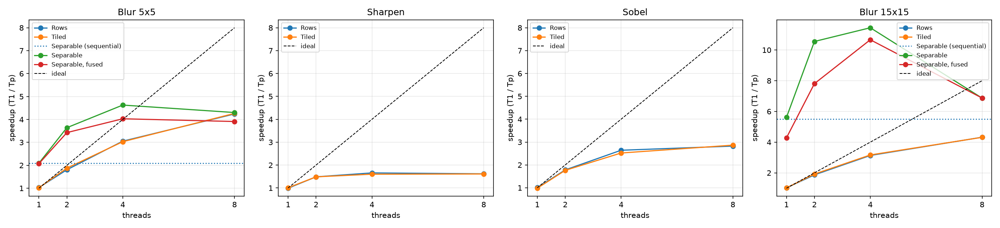
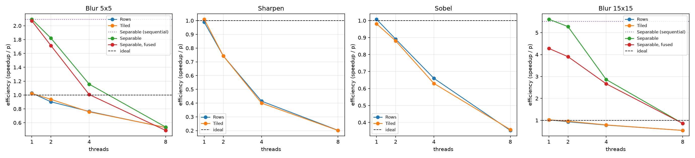
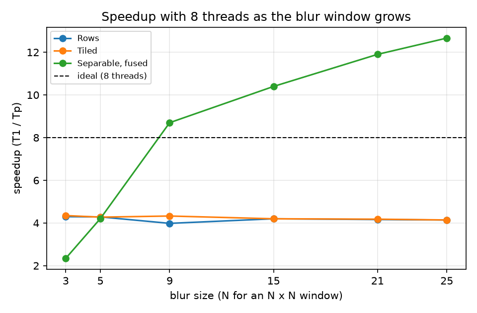
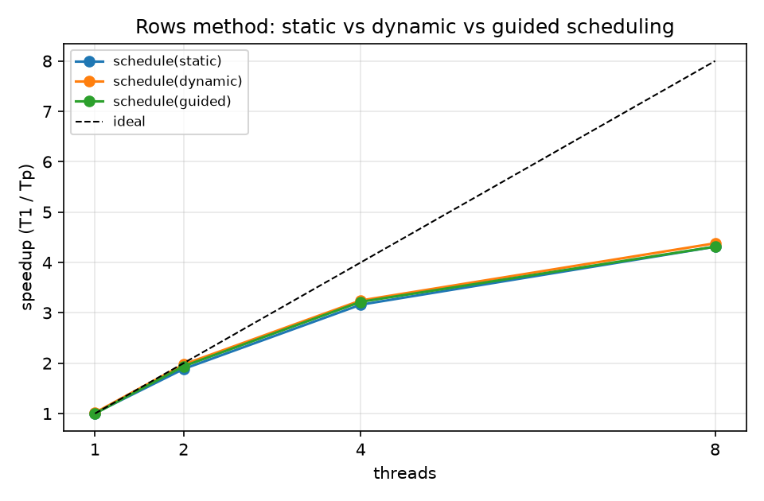
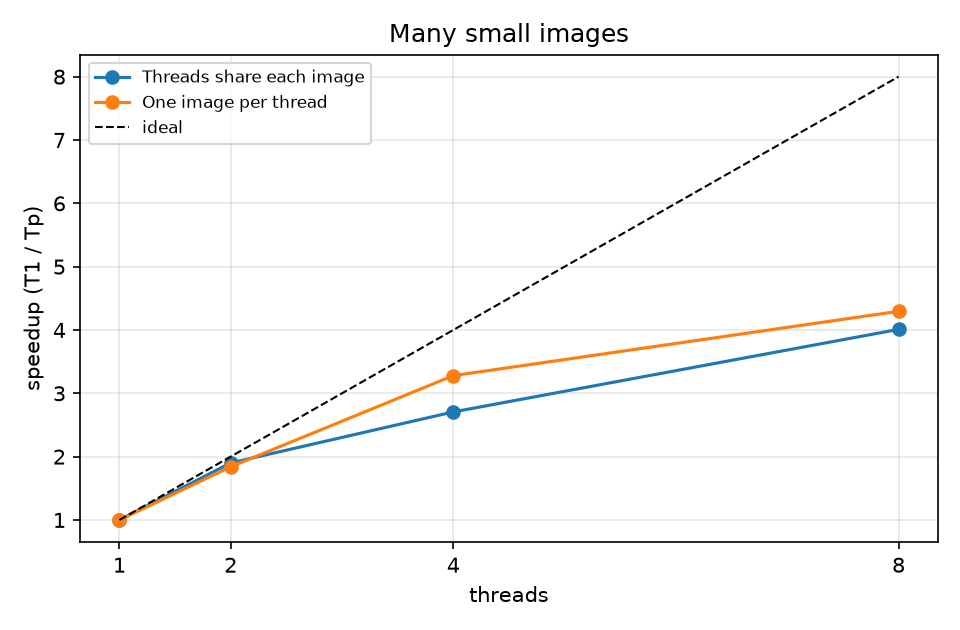

# Parallel Image Convolution / Filtering with OpenMP

**Course:** Parallel and Distributed Computing, FAST-NUCES Karachi, Fall 2026, BCS-7B
**Members:** Shayan Ahmed (23K-0551), Rizwan Vadsariya (23K-0005), Aaqib (23K-0625)
**Project:** #21 from the course project list, Parallel Image Convolution / Filtering (OpenMP)

## 1. Objective

Apply three convolution filters to large 24-bit RGB images and speed them up with
OpenMP on a multi-core CPU:

- **Gaussian blur** with an N x N window of binomial weights (N odd, 3 to 25; 5x5 is
  the main case, as in the proposal),
- **sharpen** (3x3: `5*centre - up - down - left - right`),
- **Sobel edge detection** (3x3 gradients of brightness, output |gx| + |gy|).

Problem sizes from the proposal: one **12000 x 12000** image (432 MB per RGB image)
and a batch of **3000 images of 1024 x 1024**. The sequential program is the
correctness reference and the baseline time T1; speedup is T1 / Tp and efficiency
is speedup / p.

## 2. Machine and toolchain

| | |
|---|---|
| CPU | Intel Core i7-3770, 3.4 GHz, 4 cores / 8 threads (Hyper-Threading), 256 KB L2 per core, 8 MB shared L3 |
| Memory | 8 GB DDR3 |
| OS | Windows 10 Pro (19045) |
| Compiler | GCC 16.2 (WinLibs, x86_64, UCRT), `-O3 -march=x86-64-v2 -fopenmp -static` |
| Timer | `QueryPerformanceCounter` (resolution 100 ns) |

- **64-bit compiler.** The first build used a 32-bit MinGW, which can address only
  about 2 GB; the 12000 x 12000 blur benchmark needs about 3 GB in one process
  (input, reference and output images plus the separable intermediate). We moved
  to a 64-bit GCC.
- **Timer.** MinGW's `omp_get_wtime()` only advances every 1 ms, which is up to 10 %
  error on the shortest runs here, so on Windows the program reads
  `QueryPerformanceCounter` instead.
- **`-march=x86-64-v2`** (SSE4.2) instead of `-march=native`, so the same exe runs on
  the demo laptop whatever its CPU.

## 3. Implementation

All filtering and timing is in C (`src/`). Every method writes into a separate
output image, threads only read the input, and every output pixel is written by
exactly one thread, so no locks, atomics or critical sections are needed. Only
integer arithmetic is used, so all methods produce identical bytes. Borders use
"clamp to edge" (outside pixels take the value of the nearest edge pixel).

| Method | Idea | OpenMP |
|---|---|---|
| `seq` | plain loops, one thread: reference output and T1 | none |
| `omp_rows` | rows split between threads | `parallel for schedule(runtime)`, schedule static / dynamic,1 / guided chosen with `omp_set_schedule` |
| `omp_tiled` | 16 x 2048 tiles shared between threads | `parallel for collapse(2) schedule(static)` |
| `seq_sep` | separable blur: 1-D horizontal pass, then vertical pass (2N instead of N² multiplications per pixel), one thread | none |
| `omp_sep` | both separable passes parallel over rows, full-size 32-bit intermediate | one `parallel` region, two `for` loops; the implicit barrier between them is required |
| `omp_sep_fused` | each thread does both passes on blocks of 16 rows in a private buffer; no barrier, 2r rows per block recomputed | `parallel` + `for schedule(static)`, private buffer per thread |
| batch `per_row` | images one after another, each with `omp_rows` | as `omp_rows` |
| batch `per_image` | whole images handed to free threads | `parallel for schedule(dynamic, 1)` |

**Measurement.** Best of 3 repetitions (2 for the batch and the blur-size sweep);
all buffers written once before timing ("first touch") so page faults are not
timed; the thread team started once before timing; the output filled with junk
(0xA5) before each method so a method that writes nothing cannot pass; other
programs closed during the final run.

**Verification.** After every method, at every thread count, the output is
compared byte by byte with the sequential output; the `verified` column of every
CSV row is `ok`. The automatic tests (`tests/`) also check every method on awkward
sizes (1x1, 2x3, 3x3, 4x7, 5x5, 17x9, 37x53, 128x1, 1x128, 257x131), blur sizes 3
to 25, all three schedules, and flat all-0 / all-255 images at blur size 25.

## 4. Results

All numbers below are from `results/*.csv` (final run, 1500 s in total). Figures
are in `results/plots/` and `demo/`.

### 4.1 One 12000 x 12000 image (`results/bench.csv`)

Time in seconds, speedup T1 / Tp in brackets.

| Filter | T1 (`seq`) | Method | 2 threads | 4 threads | 8 threads |
|---|---:|---|---:|---:|---:|
| Blur 5x5 | 2.621 | `omp_rows` | 1.453 (1.80) | 0.858 (3.05) | 0.618 (4.24) |
| | | `omp_tiled` | 1.398 (1.88) | 0.865 (3.03) | 0.615 (4.26) |
| | | `omp_sep` | 0.720 (3.64) | 0.567 (4.63) | 0.609 (4.30) |
| | | `omp_sep_fused` | 0.765 (3.43) | 0.651 (4.03) | 0.670 (3.91) |
| Sharpen | 0.215 | `omp_rows` | 0.145 (1.49) | 0.130 (1.66) | 0.133 (1.62) |
| | | `omp_tiled` | 0.145 (1.49) | 0.134 (1.60) | 0.134 (1.61) |
| Sobel | 0.485 | `omp_rows` | 0.272 (1.78) | 0.183 (2.64) | 0.172 (2.82) |
| | | `omp_tiled` | 0.275 (1.76) | 0.192 (2.52) | 0.169 (2.87) |
| Blur 15x15 | 16.590 | `omp_rows` | 8.877 (1.87) | 5.296 (3.13) | 3.839 (4.32) |
| | | `omp_tiled` | 8.637 (1.92) | 5.240 (3.17) | 3.846 (4.31) |
| | | `omp_sep` | 1.572 (10.56) | 1.449 (11.45) | 2.415 (6.87) |
| | | `omp_sep_fused` | 2.124 (7.81) | 1.555 (10.67) | 2.414 (6.87) |

One-thread separable times: blur 5x5 `seq_sep` 1.252 s (2.09x faster than `seq`),
blur 15x15 `seq_sep` 3.009 s (5.51x). Every row verified `ok`.

### 4.2 Blur size (`results/blur_sizes.csv`, 8000 x 8000, 8 threads)

| Blur size | T1 (s) | `omp_rows` | `omp_tiled` | `omp_sep_fused` |
|---|---:|---:|---:|---:|
| 3 | 0.536 | 4.30 | 4.35 | 2.34 |
| 5 | 1.100 | 4.29 | 4.27 | 4.21 |
| 9 | 2.954 | 3.98 | 4.33 | 8.70 |
| 15 | 7.216 | 4.20 | 4.20 | 10.40 |
| 21 | 13.476 | 4.16 | 4.18 | 11.90 |
| 25 | 18.777 | 4.14 | 4.14 | 12.66 |

(speedup over `seq` at the same blur size)

### 4.3 Loop schedule (`results/schedules.csv`, `omp_rows`, blur 5x5, 12000 x 12000)

| Schedule | 2 threads | 4 threads | 8 threads |
|---|---:|---:|---:|
| `static` | 1.322 s (1.89) | 0.788 s (3.16) | 0.578 s (4.31) |
| `dynamic, 1` | 1.272 s (1.97) | 0.774 s (3.25) | 0.573 s (4.38) |
| `guided` | 1.275 s (1.94) | 0.768 s (3.22) | 0.573 s (4.31) |

### 4.4 Batch: 3000 images of 1024 x 1024, blur 5x5 (`results/batch.csv`)

Sequential: 56.71 s (52.9 images/s).

| Threads | `per_row` time (speedup, images/s) | `per_image` time (speedup, images/s) |
|---:|---|---|
| 2 | 29.84 s (1.90, 100.5) | 30.81 s (1.84, 97.4) |
| 4 | 20.96 s (2.71, 143.2) | 17.29 s (3.28, 173.5) |
| 8 | 14.15 s (4.01, 212.1) | 13.20 s (4.30, 227.2) |

### 4.5 Thread maps (`demo/`)

Each colour is the thread that computed those pixels (sharpen, 1024 x 1024, 4
threads). `threadmap_rows_static.png`: four solid bands, one block of rows per
thread. `threadmap_rows_dynamic.png`: rows interleaved one by one, a different
pattern every run. `threadmap_tiled.png`: 128 x 256 tiles coloured by thread.

## 5. Analysis

**Scaling up to 4 threads, then Hyper-Threading.** The CPU has 4 physical cores.
From 1 to 4 threads the 2-D blur reaches 3.0 to 3.2x (efficiency about 0.76 to
0.79). Threads 5 to 8 share those 4 cores with Hyper-Threading, which can only fill
idle moments of a core, not double it: going from 4 to 8 threads adds only 1.36 to
1.41x (4.24 to 4.32x in total, efficiency 0.53 to 0.54).

**Amdahl's law.** S(p) = 1 / (f + (1 - f) / p), so the serial fraction is
f = (1/S - 1/p) / (1 - 1/p). For blur 5x5 `omp_tiled`:

- p = 4, S = 3.029: f = (0.3301 - 0.2500) / 0.7500 = **0.107**
- p = 8, S = 4.264: f = (0.2345 - 0.1250) / 0.8750 = **0.125**

The program has almost no truly serial code inside the timed region, so this
"serial fraction" mostly measures other losses: shared memory bandwidth, thread
start/stop and the implicit barrier, and (at p = 8) the fact that 8 threads are not
8 cores. It is an upper estimate of real serial work. For blur 15x15 `omp_tiled` it
is lower (0.088 at p = 4), because more arithmetic per byte hides the memory cost.

**Memory bandwidth limits sharpen and Sobel.** Sharpen does 5 operations per
channel; one pass reads 432 MB and writes 432 MB (plus 432 MB of cache-line reads
for the writes), about 1.3 GB in 0.13 s, roughly 10 GB/s, close to what this
dual-channel DDR3 machine can deliver. More threads cannot make memory faster, so
sharpen levels off at about 1.6x from 4 threads on. Sobel does more work per pixel
(brightness of 8 neighbours, two gradients) and reaches 2.8x.

**Arithmetic per byte decides scaling (blur sweep).** The 2-D blur does N² weighted
sums per channel, so it is compute-bound for every size and scales at 3.98 to 4.35x
with 8 threads regardless of N. The separable methods do only 2N, so at small N
they are memory-bound like sharpen, and the speedup over `seq` comes from both
fewer operations and threads: 2.3x at N = 3, 12.7x at N = 25.

**Separable and fused at 12000 x 12000.** The separable methods are the fastest at
every thread count for blur (best: `omp_sep` at 4 threads, 0.567 s for 5x5 and
1.449 s for 15x15, 4.6x and 11.4x over `seq`). But they scale only about 2x on
their own (`speedup_vs_self_1thread` 1.9 to 2.5 at 4 threads) and get **slower from 4 to 8
threads**: they read and write a lot of memory for little arithmetic, and extra
Hyper-Threads only add competition for the same memory and caches.

Fusing the two passes did **not** beat the plain separable version at this size,
contrary to what we expected. Two reasons, both visible in the numbers:

1. A row of 32-bit sums for a 12000-pixel row is 144 KB, so one thread's block
   buffer (16 + 2r rows) is 2.9 MB for 5x5 and 4.3 MB for 15x15. That does not fit
   in a 256 KB L2, and 4 threads' buffers do not fit in the 8 MB L3, so the
   intermediate still goes to main memory.
2. Each block recomputes 2r extra rows: 4 per 16 rows for 5x5 (+25 % horizontal
   work) and 14 per 16 rows for 15x15 (+88 %). With one thread, fused 15x15 takes
   3.875 s against 3.009 s for `seq_sep`.

At 8000 x 8000 (blur sweep) fusion scales well (2.6 to 2.8x on itself at 4 threads),
and for blur 9 and up it reaches 8.7x to 12.7x over `seq`. Making fusion pay off at
12000 would need blocks that are narrow as well as short (column strips), so the
buffer fits in L2. We kept the simpler version and report this as a measured
limitation.

**Scheduling.** The three schedules are within 2 % of each other (4.31x, 4.38x,
4.31x at 8 threads). Every row costs almost the same, so `static` is already
balanced; `dynamic, 1` hands out 12000 single rows, which costs very little next to
a row that takes about 0.2 ms of filtering. The thread maps show the difference in assignment
even though the time hardly changes.

**Batch: per-image vs per-row.** With 4 and 8 threads, giving whole images to
threads is faster (3.28x vs 2.71x at 4 threads; 4.30x vs 4.01x at 8). `per_row`
starts and ends a parallel loop, with a barrier, for each of the 3000 images and
splits a 1024-row image into small pieces, so threads wait at each barrier for the
slowest one. `per_image` has no barrier between images and each thread works on
its own image, with `schedule(dynamic, 1)` keeping all threads busy to the end.
With 2 threads `per_row` is slightly ahead (1.90x vs 1.84x).

**Blur speed after generalising the size.** The first version had the 5x5 blur
written out for one size; the final version accepts any odd size from 3 to 25 with
one set of loops. That made the 5x5 blur about 3x slower in absolute time than
the fixed-size code. All speedups are measured against the same new sequential
version, so the parallel conclusions are not affected; we chose one clear
implementation for all sizes over a separate fast path for 5x5.

## 6. Deviations from the proposal

- 32-bit MinGW replaced by a 64-bit GCC, needed for the 12000 x 12000 image.
- `omp_get_wtime` replaced by `QueryPerformanceCounter` on Windows (1 ms -> 100 ns).
- Blur size made variable (3 to 25) to study how arithmetic per pixel changes
  scaling; 5x5 stays the main case.
- Added the scheduling comparison, thread maps and a desktop app for the demo;
  `-march=x86-64-v2` so the same exe runs on another computer.

## 7. Conclusion

All six methods and both batch strategies produce byte-identical output to the
sequential program for every size and thread count tested. On a 4-core / 8-thread
CPU the 2-D filters reach about 3x with 4 threads and 4.3x with 8 (blur), limited
by physical cores and memory bandwidth; low-arithmetic filters (sharpen) are
memory-bound at 1.6x. The separable blur gives the fastest blur by doing less work
(up to 11.4x over `seq` for 15x15), but scales poorly because it is memory-bound,
and fusing its passes helps only when the per-thread buffer fits in the cache
(8000 width, not 12000). For many small images, one image per thread beats
splitting each image. The experiments match the course concepts: Amdahl's law,
memory-bound vs compute-bound work, the cost of barriers, and the limits of
Hyper-Threading.
